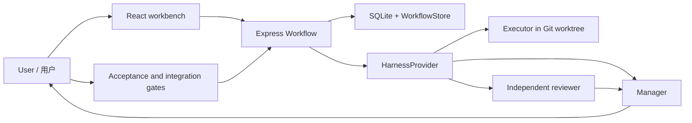

# Architecture / 架构

- `shared/workflow.ts`: proposals, role profiles, criteria, review contracts and objective acceptance rules.
- `shared/quota.ts` and `services/quota.ts`: separate account/source adapters, owner-only quota route, shared one-minute cache and optional source attribution; see [quota contract](QUOTA.md).
- `shared/workbench.ts`: project overview, appearance and versioned source integration contracts.
- `packages/server/src/services/workflow.ts`: lifecycle, dependency/revision checks, bounded advancement and Git integration.
- Tools directory policy lives in `workflow-store.ts` and is exposed in scoped AI context and dispatch instructions; setting it does not grant installation permission.
- `workflow-store.ts`: persisted project context/configuration; `harness.ts`: adapters; `local-service.ts`: native Windows startup actions.
- `ai-access.ts`: hashed project credentials; `ai-integration.ts`: read/preview-only HTTP gateway. Imported drafts reuse the workflow's Proposal and confirmation gate; `scripts/sonail-mcp.mjs` is a stdio bridge using the official SDK.
- `packages/client/src/components/Workbench.tsx`: product entry at `/workbench`. Project hub, manager records and integration settings remain separate UI concerns. `/projects` retains upstream execution detail.

Adapters must report capabilities and failures honestly, preserve selected models/effort, and never treat finished execution as accepted work. Objective automation requires passing independent reviewer and manager evidence. Human criteria are never automatically accepted. Supplementary manager adjustments are audited and cannot change canonical criteria.

集成扩展使用 `IntegrationAdapter<T>` / `apiVersion: 1`，通过源码实现并编译接入。它不是动态插件市场。角色与任务、模型与费用来源、执行与验收保持独立。

## Role-aware model selection / 按角色选档

Automatic executor selection uses task complexity (small: first candidate; standard: middle; deep: last). Automatic manager and independent reviewer selection always uses the last, user-ranked strongest candidate, even when the worker task is small. Validation retries follow the same role policy. Candidate order describes intended capability, not measured price or quality; no model IDs or providers are invented. Fixed profiles and task executor overrides retain their existing behavior. Auto off or an empty candidate list uses the configured manual profile. Unsupported selected models fail explicitly; they do not fall back to another tier.

执行者自动按任务复杂度选档；经理与独立审查者始终选各自允许列表最后一项（用户排序的最强档），不随小任务降档。格式纠正重试遵循同一角色策略。顺序不代表已验证的价格或能力；固定模型保持不变，自动关闭或列表为空时沿用手动配置，不支持的模型直接报错而不替换。独立审查、限次返工及人工体验验收仍是独立关卡；这不宣称已经节省成本。
